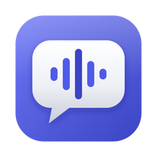
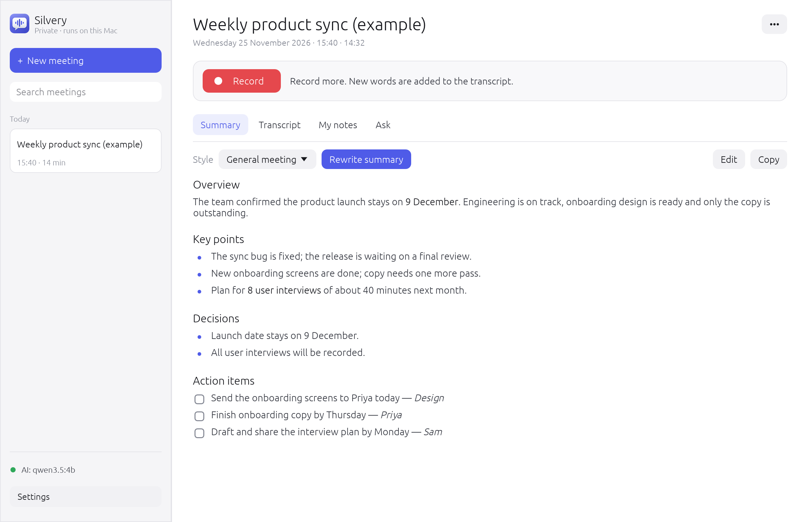

<p align="center">
  
</p>

<h1 align="center">Silvery</h1>

<p align="center">
  <b>Private meeting notes that never leave your computer.</b><br>
  Record a meeting, get a live transcript, and let a local AI write the summary and action items.
</p>

<p align="center">
  
</p>

## What it does

- **Record**: one big button records the microphone. A live sound wave shows how loud you are.
- **Transcribe on your computer**: speech turns into text with [Whisper](https://github.com/ggml-org/whisper.cpp),
  running offline. New text appears about every 12 seconds while people talk.
- **Your own notes**: type notes alongside the recording. The AI reads them too.
- **AI summary, written locally**: when you press Stop, a local model in [Ollama](https://ollama.com)
  writes an overview, key points, decisions and a to-do list you can tick off. There are five styles:
  general meeting, one-on-one, stand-up, customer call and interview.
- **Ask about the meeting**: questions like "What did we decide?" or "Write a follow-up email",
  answered only from that meeting.
- **Find and share**: search all meetings, copy a meeting as text, or save it as a Markdown file.
- **Runs on** macOS (Apple chip and Intel), Windows (x64 and ARM) and Linux (x86_64 and ARM).

## Privacy

Recordings, transcripts, notes and summaries are stored only on your computer. The AI runs on your
computer through Ollama, and speech-to-text runs on your computer through Whisper. The only download is
the speech model (about 150 MB, once). Silvery has no accounts, no cloud and no analytics.

## Download

Click the download for your computer. The links always fetch the **newest version**:

| Your computer | Download |
|---|---|
| 🍎 Mac with an Apple chip (M1, M2, M3, M4…) | **[Silvery for Mac (Apple chip)](../../releases/latest/download/Silvery-macOS-AppleSilicon.zip)** |
| 🍎 Mac with an Intel chip | **[Silvery for Mac (Intel)](../../releases/latest/download/Silvery-macOS-Intel.zip)** |
| 🪟 Windows 10/11 PC | **[Silvery for Windows](../../releases/latest/download/Silvery-Windows-x64.zip)** |
| 🪟 Windows 11 on ARM (Snapdragon laptops) | [Silvery for Windows on ARM](../../releases/latest/download/Silvery-Windows-arm64.zip) |
| 🐧 Linux PC (Intel/AMD) | **[Silvery for Linux](../../releases/latest/download/Silvery-Linux-x86_64.tar.gz)** |
| 🐧 Linux on ARM (Ubuntu on Apple-chip Macs, Raspberry Pi 4/5) | [Silvery for Linux on ARM](../../releases/latest/download/Silvery-Linux-arm64.tar.gz) |

**Which one?** On a Mac: Apple menu › *About This Mac*: "Chip: Apple M…" means Apple chip.
On Windows: Settings › System › About › *System type* ("ARM-based processor" means ARM).
On Linux: `uname -m` prints `x86_64` or `aarch64` (= ARM).

What's new in each version, and older versions: [Releases page](../../releases/latest).
Install steps for each system are in the [user guide](docs/user-guide.md#installing-silvery).
**Mac, first time only:** if macOS says *"Apple could not verify Silvery.app…"*, press **Done**, then
**System Settings › Privacy & Security › Open Anyway**. Silvery isn't signed with an Apple developer
certificate yet ([how to add one](docs/releasing.md#removing-the-macos-warning-developer-id-signing-and-notarization)).

## Quick start

1. **Install Ollama** from [ollama.com](https://ollama.com), then download a model:
   ```sh
   ollama pull qwen3:8b        # or a smaller one, e.g. qwen3:4b
   ```
2. **Get Silvery** from the [Releases page](../../releases/latest), or build it yourself (below).
3. **Open Silvery** and press **Record**. The first time:
   - macOS asks for microphone access. Choose **Allow**.
   - Silvery downloads its speech model once.
4. Press **Stop**. The summary appears in the **Summary** tab a few seconds later.

The full walkthrough is in the **[user guide](docs/user-guide.md)**.

## Building

Each kind of computer has a release script in [`release/`](release/README.md). Each one puts a ready-to-share
download in `dist/release/`:

| For | Script | Runs on |
|---|---|---|
| Mac, Intel chip | `./release/macos-intel.sh` | any Mac |
| Mac, Apple chip | `./release/macos-apple-silicon.sh` | any Mac |
| Linux, Intel/AMD | `./release/linux-x86_64.sh` | Linux, or any computer with Docker |
| Linux, ARM | `./release/linux-arm64.sh` | Linux, or any computer with Docker |
| Windows, Intel/AMD | `.\release\windows-x64.ps1` | Windows (PowerShell) |
| Windows, ARM | `.\release\windows-arm64.ps1` | Windows on ARM (PowerShell) |

Pushing a version tag makes GitHub run all six and publish a release; see [Releasing](docs/releasing.md).
For everyday development, plain `cargo build --release` works once the tools are installed. Details and
requirements: **[build guide](docs/building.md)**.

## Documentation

- [User guide](docs/user-guide.md): recording, summaries, Ask, settings, troubleshooting
- [Build guide](docs/building.md): building for macOS, Linux and Windows
- [Releasing](docs/releasing.md): publishing a new version on GitHub
- [How it works](docs/how-it-works.md): architecture, data files and test options for developers

## Built with

[Rust](https://www.rust-lang.org) · [egui / eframe](https://github.com/emilk/egui) (window and UI) ·
[whisper.cpp](https://github.com/ggml-org/whisper.cpp) via [whisper-rs](https://github.com/tazz4843/whisper-rs)
(speech-to-text) · [cpal](https://github.com/RustAudio/cpal) (microphone) ·
[Ollama](https://ollama.com) (local AI) · [ureq](https://github.com/algesten/ureq) (talking to Ollama)

## License

MIT. See [LICENSE](LICENSE). Whisper models and the libraries above have their own licenses.
