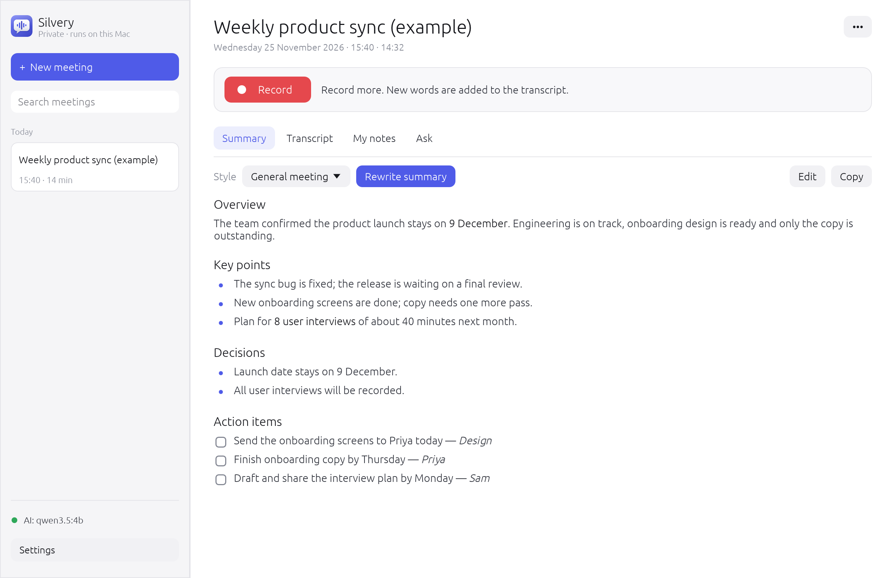
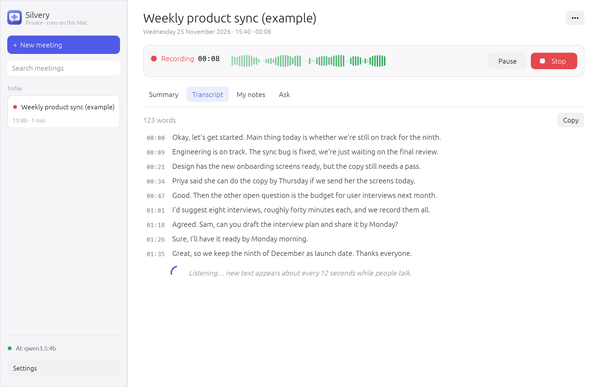
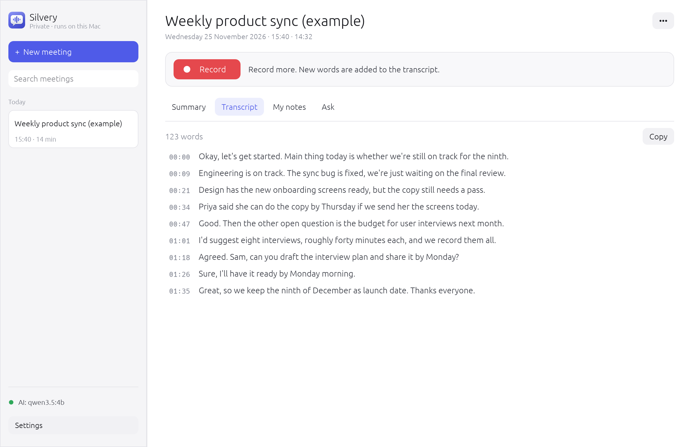
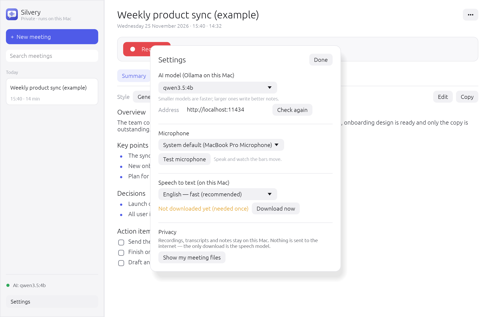

# Silvery user guide

Silvery records your meetings, turns speech into text on your computer and uses a local AI to
write the notes. Nothing is sent to the internet.

- [Before you start](#before-you-start)
- [The window](#the-window)
- [Recording a meeting](#recording-a-meeting)
- [Transcript](#transcript)
- [My notes](#my-notes)
- [Summary](#summary)
- [Ask](#ask)
- [Finding, copying and saving meetings](#finding-copying-and-saving-meetings)
- [Settings](#settings)
- [Where your meetings are kept](#where-your-meetings-are-kept)
- [Troubleshooting](#troubleshooting)

---

## Before you start

**1. Install Ollama (the local AI).** Download it from [ollama.com](https://ollama.com) and open it once.
Then download a model in Terminal (or Command Prompt on Windows):

```sh
ollama pull qwen3:8b
```

| Model | Size | Good for |
|---|---|---|
| `qwen3:4b`, `qwen3.5:4b` | ~3 GB | Fast, fine for most meetings, computers with 8 GB memory |
| `qwen3:8b` | ~5 GB | Better notes, 16 GB memory recommended |
| `gpt-oss`, larger models | 13 GB+ | Best quality, needs a powerful computer |

Silvery picks a model automatically. You can change it in **Settings**. If Ollama isn't running,
Silvery tries to start it.

**2. The speech model.** The first time you record, Silvery downloads its speech-to-text model once
(about 150 MB). You can also do this ahead of time in **Settings › Speech to text › Download now**.

**3. Microphone permission (macOS).** Open Silvery as an app (`Silvery.app`). The first time you record,
macOS asks *"Silvery would like to access the microphone"*. Choose **Allow**.
On Windows, the microphone switch is in Settings › Privacy & security › Microphone.

---

## The window



- **Left:** your meetings, newest first, grouped by day, with **New meeting**, **Search** and, at the
  bottom, the AI status (green = ready) and **Settings**.
- **Right:** the open meeting, with its title (click to rename), date and length, the **Record** bar and
  four tabs: **Summary**, **Transcript**, **My notes** and **Ask**.

The first time you open Silvery, an example meeting shows what finished notes look like. You can
delete it from the **•••** menu.

---

## Recording a meeting

1. Press **New meeting** (or open an existing meeting to record more).
2. Press **Record**.



While recording you see:

- a pulsing **red dot**, the word **Recording** and the **timer**;
- a **live sound wave** of the last few seconds. Grey bars mean quiet, green means a good level,
  and red means too loud. Speak so the bars are mostly green;
- **Pause / Resume**: nothing is recorded while paused;
- **Stop**: ends the recording. The last words are transcribed, and then the summary is written for you
  automatically.

If no sound reaches Silvery for a few seconds, a red message explains what to check
(microphone permission, a muted microphone, or choosing another microphone).

> Tip: Silvery records **your microphone**. In a video call it hears the other people through your
> speakers, so headphones lower their volume in the recording.

---

## Transcript



Each line shows the **time** in the meeting and **what was said**. While recording, new text appears
about every 12 seconds. Silvery waits for a pause, so words aren't cut in half. **Copy** puts the whole
transcript on the clipboard.

Recording again in the same meeting **adds** to the transcript.

---

## My notes

Type your own notes at any time, during or after the meeting. They're saved automatically, and the AI
reads them together with the transcript when it writes the summary, so you can add names, context or
"remember to…" items it should include.

---

## Summary

After you press **Stop**, the summary is written automatically on your computer, usually within
5–30 seconds depending on the model.

- **Style:** choose how the notes are organised:

  | Style | Sections |
  |---|---|
  | General meeting | Overview · Key points · Decisions · Action items |
  | One-on-one | Overview · Updates · Challenges & support · Feedback · Next steps |
  | Stand-up | Done · Today · Blockers · Follow-ups |
  | Customer call | Overview · Needs & pain points · Questions & objections · Next steps |
  | Interview | Overview · Background · Strengths · Concerns · Quotes · Next steps |

- **Write summary / Rewrite summary:** writes it again, for example after you change the style or add notes.
  **Stop writing** stops it partway.
- **Action items** have **checkboxes**: tick them off as you go.
- **Edit:** change the text yourself, then press **Done**.
- **Copy:** copies the summary.
- If the meeting is still **Untitled**, the AI also gives it a short title.

The AI only uses what was said and what you typed. If something is missing, add it in **My notes** and
press **Rewrite summary**.

---

## Ask

Ask questions about **this meeting only**, for example:

- *What did we decide?*
- *What are my action items?*
- *Write a short follow-up email*

Press one of the suggestions or type your own and press **Enter**. If the answer isn't in the meeting,
the AI says so.

---

## Finding, copying and saving meetings

- **Search** (top left) looks through titles, transcripts, notes and summaries.
- The **•••** menu (top right of a meeting) has:
  - **Copy as text:** title, summary, notes and transcript as Markdown;
  - **Save to Downloads:** the same as a `.md` file in your Downloads folder;
  - **Delete meeting:** removes the meeting and its recording (asks first).

---

## Settings



| Setting | What it does |
|---|---|
| **AI model** | Which Ollama model writes summaries and answers. *Check again* reconnects. *Address* is normally `http://localhost:11434`. |
| **Microphone** | Which microphone to record from. *Test microphone* shows the live sound wave without recording. |
| **Speech to text** | *English, fast* (recommended), *English, more accurate*, or *Any language*, with a language choice or automatic detection. Larger models are more accurate but slower. |
| **Show my meeting files** | Opens the folder where Silvery keeps everything. |

---

## Where your meetings are kept

| System | Folder |
|---|---|
| macOS | `~/Library/Application Support/Silvery` |
| Windows | `%APPDATA%\Silvery` |
| Linux | `~/.local/share/Silvery` |

Inside it:

- `meetings/`: one `.json` file per meeting (title, notes, transcript, summary, Ask conversation);
- `recordings/`: the audio of each recording as a `.wav` file (16 kHz mono);
- `models/`: the speech model;
- `settings.json`: your settings.

To back up your meetings, copy this folder. To move to a new computer, copy it to the same place there.

---

## Troubleshooting

**"No sound is coming in" / the sound wave stays flat**
- macOS: open Silvery as an app (`Silvery.app`). If you're running it another way, press **Open Silvery app**.
  Make sure it's allowed in System Settings › Privacy & Security › Microphone, then press Stop and Record again.
- Windows: Settings › Privacy & security › Microphone › turn on *Let desktop apps access your microphone*.
- Check that the microphone isn't muted, or choose another one in **Settings › Microphone**.

**"AI offline — open Ollama"**
Start the Ollama app, then press **Settings › Check again**. If it says no models are installed, run
`ollama pull qwen3:8b`.

**The summary is slow**
Choose a smaller model in Settings (for example `qwen3:4b`). The first summary after starting Ollama is
slower because the model is loading.

**The transcript is slow or misses words**
Speak closer to the microphone (aim for green bars). On a fast computer, try **English, more accurate**.
For other languages, choose **Any language** and set the language.

**macOS says the app is from an unidentified developer**
Right-click `Silvery.app` › **Open** › **Open**. This is only needed the first time.

**Linux: "version `GLIBC_2.38' not found"**
That build was made on a newer Linux than yours. Build Silvery on your own machine (see the
[build guide](building.md)) or use a build made for older Linux.

**After updating Silvery, macOS asks for the microphone again**
That's expected for apps without an Apple developer certificate. Choose **Allow** again.
